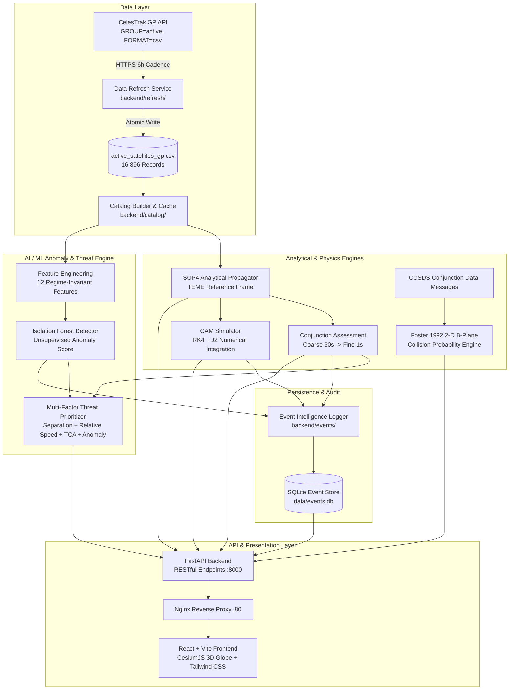

# ADITI 4.0 (PS24) — AI-Driven Space Situational Awareness & Training Platform

An indigenous, enterprise-grade research and educational Space Situational Awareness (SSA) platform combining physics-based orbital mechanics, unsupervised machine learning for non-Keplerian anomaly detection, multi-factor threat screening, impulsive collision avoidance maneuver (CAM) simulation, persistent event intelligence, and CCSDS Conjunction Data Message (CDM) collision probability analysis.

---

## 🛰️ 1. Platform Overview & Problem Statement

The rapid expansion of commercial mega-constellations and debris fragments in Low Earth Orbit (LEO) and Geostationary Earth Orbit (GEO) has dramatically escalated orbital collision risks. Contemporary SSA challenges include:

1. **High Ingestion Volume**: Tracking tens of thousands of active payloads and debris objects requiring continuous ephemeris updates.
2. **Computational Bottlenecks in Conjunction Screening**: Evaluating $O(N^2)$ orbital object pairs across multi-day search windows without prohibitive compute overhead.
3. **Maneuver & Non-Keplerian Anomaly Detection**: Detecting unannounced orbital maneuvers, abnormal atmospheric drag, or attitude degradation without ground-truth telemetry.
4. **Actionable Collision Mitigation**: Modeling impulsive avoidance maneuvers with gravitational perturbations and evaluating risk reduction.
5. **Rigorous Uncertainty vs. Heuristic Separation**: Distinguishing empirical operational priority rankings from mathematically certified 2-D collision probability ($P_c$).

**ADITI 4.0 PS24** addresses these challenges through an end-to-end, layered software architecture designed for course demonstration, academic evaluation, and SSA operator training.

> [!IMPORTANT]
> **Course Demonstration & Research Disclaimer**: ADITI 4.0 is an academic research prototype operating on public General Perturbations (GP) / Two-Line Element (TLE) datasets. It is **not** an operational military surveillance system or certified flight-safety collision avoidance pipeline.

---

## 🏗️ 2. System Architecture



---

## 🌟 3. Key Capabilities Across All Layers

| Layer / Component | Source Module | Architectural Function |
|---|---|---|
| **Layer 1: Orbital Data Ingestion** | `backend/orbital/gp_loader.py` | Space-Track / CelesTrak GP CSV schema validation, UTC epoch parsing, NORAD index indexing. |
| **Layer 2: SGP4 Propagation Engine** | `backend/orbital/sgp4_propagator.py` | Analytical propagation in the TEME frame, generating state vectors $\mathbf{r}(t)$ (km) and $\mathbf{v}(t)$ (km/s). |
| **Layer 3: Conjunction Screening** | `backend/orbital/conjunction.py` | Two-phase coarse-to-fine search (60s coarse step $\to$ 1s fine step) for accurate Time of Closest Approach (TCA). |
| **Layer 7: ML Feature Engineering** | `ml/pipeline/feature_engineering.py` | Derives 12 orbital dynamic and rate-of-change features invariant across LEO, MEO, and GEO regimes. |
| **Layer 8: Anomaly Detection** | `ml/models/anomaly_detector.py` | Unsupervised **Isolation Forest** model detecting non-Keplerian behavior, normalized to $[0, 1]$. |
| **Layer 9: Threat Prioritization** | `ml/models/threat_scorer.py` | 4-factor operational priority scoring combining miss distance, relative speed, time-to-TCA, and anomaly score. |
| **Layer 10: Unified Catalogue** | `backend/catalog/` | Unified in-memory catalogue with SATCAT metadata, regime filtering, and file mtime-based cache invalidation. |
| **Layer 11: Threat Screening API** | `backend/api/routes.py` | RESTful FastAPI routes with strict Pydantic request/response schemas and standardized error responses. |
| **Layer 12: Automated Ingestion** | `backend/refresh/` | FastAPI lifecycle-managed scheduler (6-hour interval, 2-hour cooldown), atomic file swap, and audit metadata. |
| **Layer 13: Multi-Object 3D Globe** | `frontend/src/components/globe/` | High-performance CesiumJS digital globe with TEME $\to$ ECEF coordinate transforms and multi-satellite trajectory arcs. |
| **Feature 1: Collision Avoidance Maneuver** | `backend/orbital/maneuver_simulator.py` | Impulsive $\Delta\mathbf{V}$ simulation with numerical **Runge-Kutta 4 (RK4)** two-body + $J_2$ post-maneuver trajectory propagation. |
| **Feature 2: Event Timeline & Audit** | `backend/events/` | Deterministic rule-based maneuver classification (`STATION_KEEPING`, `ORBIT_RAISE`, `ORBIT_DECAY`, `UNKNOWN`) in SQLite. |
| **Feature 3: Collision Probability ($P_c$)** | `backend/orbital/collision_probability.py` | CCSDS CDM parser and **Foster's (1992) 2-D encounter-plane method** with strict covariance matrix validation. |
| **Feature 4: Docker Containerization** | `docker-compose.yml` | Multi-stage Docker builds, Nginx reverse proxy, non-root execution, healthchecks, and data volume persistence. |

---

## 📐 4. Mathematical & Algorithmic Formulations

### 4.1 Numerical CAM Propagation (RK4 + $J_2$)
Post-maneuver state integration solves the differential equation:
$$\ddot{\mathbf{r}} = -\frac{\mu}{\|\mathbf{r}\|^3}\mathbf{r} + \mathbf{a}_{J_2}$$

Where the oblateness perturbation acceleration $\mathbf{a}_{J_2}$ in the geocentric frame is:
$$\mathbf{a}_{J_2} = -\frac{3}{2} J_2 \frac{\mu R_e^2}{r^5} \begin{bmatrix} x \left(1 - 5\frac{z^2}{r^2}\right) \\ y \left(1 - 5\frac{z^2}{r^2}\right) \\ z \left(3 - 5\frac{z^2}{r^2}\right) \end{bmatrix}$$

- Geocentric gravitational parameter: $\mu = 398600.4418 \text{ km}^3/\text{s}^2$
- Earth equatorial radius: $R_e = 6378.137 \text{ km}$
- Earth second zonal harmonic: $J_2 = 1.08263 \times 10^{-3}$

Numerical integration is carried out using a fixed-step 4th-order Runge-Kutta integrator ($h = 60\text{ s}$ default, refined to $10\text{ s}$ near encounter).

### 4.2 Foster's (1992) 2-D Collision Probability ($P_c$)
In the encounter reference frame (B-plane) oriented perpendicular to relative velocity $\mathbf{v}_{\text{rel}} = \mathbf{v}_1 - \mathbf{v}_2$:
1. The relative position covariance matrix $C = C_1 + C_2$ is projected onto the 2-D encounter plane $(x, y)$.
2. Diagonalization yields principal axes variances $\sigma_1^2$ and $\sigma_2^2$.
3. For a combined hard-body radius $r_{\text{hbr}} = r_1 + r_2$, the probability of collision is:
$$P_c = \frac{1}{2\pi \sigma_1 \sigma_2} \iint_{x^2 + y^2 \le r_{\text{hbr}}^2} \exp\left(-\frac{1}{2}\left[\frac{(x - x_0)^2}{\sigma_1^2} + \frac{(y - y_0)^2}{\sigma_2^2}\right]\right) dx dy$$
4. When $r_{\text{hbr}} \ll \min(\sigma_1, \sigma_2)$, the circular disk approximation provides an efficient, closed-form evaluation:
$$P_c \approx \frac{r_{\text{hbr}}^2}{2 \sigma_1 \sigma_2} \exp\left(-\frac{1}{2}\left[\frac{x_0^2}{\sigma_1^2} + \frac{y_0^2}{\sigma_2^2}\right]\right)$$

### 4.3 Multi-Factor Threat Screening Heuristic
Operational screening priority uses a bounded heuristic:
$$S_{\text{risk}} = w_{\text{sep}} f_{\text{sep}}(d_{\text{min}}) + w_{\text{vel}} f_{\text{vel}}(v_{\text{rel}}) + w_{\text{tca}} f_{\text{tca}}(\Delta t_{\text{tca}}) + w_{\text{anom}} f_{\text{anom}}$$
- Weights: $w_{\text{sep}} = 0.40$, $w_{\text{vel}} = 0.20$, $w_{\text{tca}} = 0.25$, $w_{\text{anom}} = 0.15$.
- Normalized output: $S_{\text{risk}} \in [0.0, 1.0]$.
- **Distinction**: Threat Score is an operational triage heuristic. It is **never** presented as physical collision probability ($P_c$).

---

## 🤖 5. Machine Learning Pipeline

- **Algorithm**: Unsupervised `IsolationForest` from `scikit-learn`.
- **Contamination Rate**: $0.05$ (top 5% flagged as potential anomalies).
- **Engineered Features (12 Total)**:
  1. Mean motion deviation $\Delta n$
  2. Semi-major axis deviation $\Delta a$
  3. Eccentricity $e$
  4. Inclination deviation $\Delta i$
  5. BSTAR drag term magnitude
  6. Rate of change of mean motion $\dot{n}$
  7. Second derivative of mean motion $\ddot{n}$
  8. Perigee altitude $h_p$
  9. Apogee altitude $h_a$
  10. Apogee-to-perigee altitude ratio $h_a / h_p$
  11. Orbital energy $E = -\mu / (2a)$
  12. Orbital angular momentum magnitude $h = \sqrt{\mu a (1 - e^2)}$
- **Scoring**: Raw decision function inverted and normalized via logistic sigmoid to $[0.0, 1.0]$.

---

## 🔄 6. Automated CelesTrak Ingestion Engine

- **Upstream Data Source**: `https://celestrak.org/NORAD/elements/gp.php?GROUP=active&FORMAT=csv`
- **Cadence**: 6 hours (configurable via `ADITI_REFRESH_INTERVAL_HOURS`).
- **Cooldown & Rate-Limit Compliance**: Enforces strict 2-hour minimum cooldown between remote fetches matching CelesTrak's publication cycle.
- **Fail-Safe Mechanism**:
  1. Downloads upstream GP CSV to temporary file `active_satellites_gp.csv.tmp`.
  2. Validates CSV headers, row counts (>1,000 required), and orbital epoch formats.
  3. Performs atomic replacement `os.replace` to prevent corrupted states during concurrent reads.
  4. Preserves last-known-good catalog and emits dashboard warning on network timeout or upstream HTTP error.

---

## 🛠️ 7. Tech Stack

- **Backend**: Python 3.12+ / 3.13, FastAPI, Uvicorn, SGP4, SciPy, NumPy, Scikit-learn, Pydantic v2, SQLite3.
- **Frontend**: TypeScript, React 18, Vite 5, Tailwind CSS, Lucide React, CesiumJS (Resium).
- **Deployment**: Multi-stage Dockerfiles (`Dockerfile.backend`, `Dockerfile.frontend`), Docker Compose, Nginx Alpine reverse proxy.

---

## 🚀 8. Quick Start & Local Setup

### 8.1 Prerequisites
- Python 3.12 or 3.13
- Node.js 18+ and npm
- Git

### 8.2 Backend Setup
```bash
cd aditi-4-ps24-ssa-platform

# 1. Create and activate virtual environment (optional)
python -m venv .venv
source .venv/bin/activate  # Windows: .venv\Scripts\activate

# 2. Install dependencies
pip install -r requirements.txt

# 3. Start backend API server
python -m uvicorn backend.main:app --host 0.0.0.0 --port 8000 --reload
```
Interactive API documentation will be available at `http://localhost:8000/docs`.

### 8.3 Frontend Setup
```bash
cd frontend

# 1. Install dependencies
npm install

# 2. Start Vite development server
npm run dev
```
Open your browser at `http://localhost:5173`.

---

## 🐳 9. Docker Deployment

Deploy the entire production stack in isolated containers with persistence:

```bash
# 1. Build and start containers
docker compose up --build -d

# 2. Check container status
docker compose ps

# 3. View unified logs
docker compose logs -f
```

- **Frontend Application**: `http://localhost/` (Port 80)
- **Backend API & Swagger Docs**: `http://localhost:8000/docs` (or via Nginx reverse proxy `http://localhost/api/`)
- **Volume Mounts**: `./data` directory persists SQLite database (`events.db`), refreshed GP catalogue (`active_satellites_gp.csv`), and refresh metadata (`refresh_metadata.json`).

To gracefully terminate the stack:
```bash
docker compose down
```

---

## 🧪 10. Automated Test Suite

Run the full backend test regression suite:
```bash
python -m pytest tests/ -v
```

**Verification Results**:
- **Total Tests**: 226 passed
- **Execution Time**: ~129s
- **Coverage**:
  - `test_api.py`: FastAPI route verification, schema validation, error handling.
  - `test_threat_api.py`: Threat prioritization, pagination, filter criteria, future epoch handling.
  - `test_data_refresh.py`: CelesTrak CSV ingestion, cooldown timer, atomic swap, metadata persistence.
  - `test_maneuver_simulator.py`: RK4 integration, $\Delta\mathbf{V}$ calculation, miss distance changes.
  - `test_collision_probability.py`: CCSDS CDM parser, Foster 2D B-plane math, covariance validation.
  - `test_event_intelligence.py`: SQLite audit store, event filtering, maneuver classification heuristics.

Run frontend type checking and production build:
```bash
cd frontend
npm run build
```
- **TypeScript**: 0 errors.
- **Vite Build**: Production bundle generated in `< 7 seconds`.

---

## 🌐 11. REST API Reference

| Endpoint | Method | Description |
|---|---|---|
| `/health` | `GET` | Health status and uptime of the API server. |
| `/catalog/status` | `GET` | Active catalogue metadata, object count, and epoch freshness. |
| `/catalog/objects` | `GET` | Paginated orbital records with regime and name filtering. |
| `/catalog/objects/{norad_id}` | `GET` | Detailed Keplerian parameters and propagation metadata. |
| `/propagate` | `POST` | SGP4 propagation generating TEME positions and velocities. |
| `/conjunction/screen` | `POST` | Pairwise close-approach screening with coarse-to-fine search. |
| `/maneuver/simulate` | `POST` | Impulsive $\Delta\mathbf{V}$ CAM simulation using RK4 + $J_2$. |
| `/cdm/parse` | `POST` | Parses CCSDS Conjunction Data Message text into structured JSON. |
| `/pc/compute` | `POST` | Evaluates Foster 2D collision probability from encounter parameters. |
| `/pc/from-cdm` | `POST` | End-to-end CDM parsing and Foster 2D probability computation. |
| `/events` | `GET`, `POST` | Queries and logs historical orbital events and classifications. |
| `/events/stats` | `GET` | Summary statistics of logged conjunctions and maneuvers. |
| `/threat/screen` | `POST` | Catalogue-wide threat prioritization and anomaly ranking. |
| `/refresh/trigger` | `POST` | Triggers an immediate upstream CelesTrak catalogue refresh. |
| `/refresh/status` | `GET` | Refresh scheduler status, last attempt, and cooldown timer. |

---

## ⚠️ 12. Scientific Disclaimers & Operational Limits

1. **Analytical SGP4 Precision**: SGP4 is an analytical theory suited for coarse tracking. Atmospheric drag and solar radiation pressure uncertainties compound over time; propagation beyond 3–5 days degrades significantly.
2. **Advance Predicted Ephemerides (Future Epochs)**: Operational GP datasets occasionally include advance predicted ephemerides (e.g., Chandra CXO #25867). SGP4 supports negative $t_{\text{since}}$ analytically. Freshness calculations compute absolute epoch deviation $|t_{\text{now}} - t_{\text{epoch}}|$ to prevent false exclusion.
3. **Absence of Covariance in TLEs**: Public Two-Line Element sets do not include positional uncertainty ($3\times3$ covariance matrices). Physical collision probability ($P_c$) cannot be computed from TLEs alone without synthesizing unvalidated covariance.
4. **Heuristic vs. Certified Safety**: The Threat Priority Score is an operational triage heuristic. It must never be construed as an operational collision warning or replacement for official conjunction data messages issued by military or civil space agencies.
