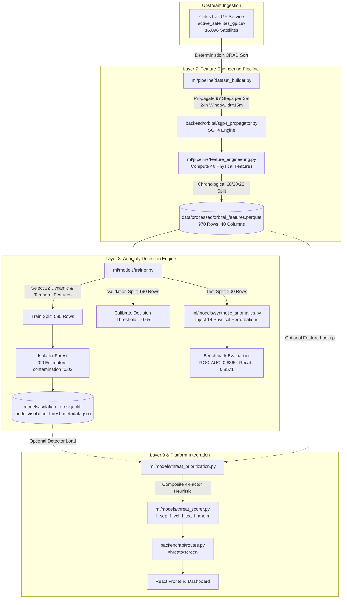
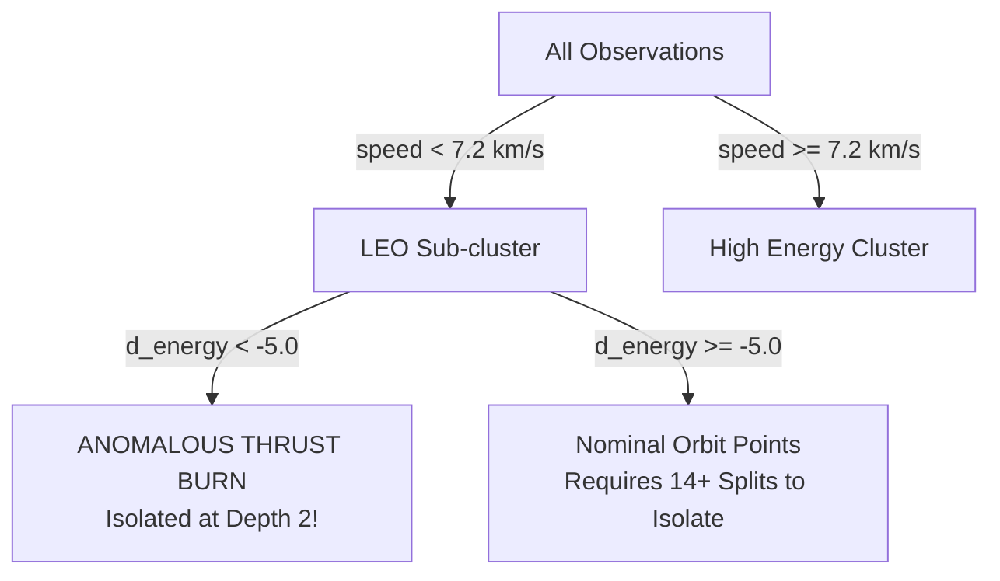

# ADITI 4.0 PS24 — Machine Learning Pipeline Deep Dive

> **Course Project Engineering Reference**: This document provides a complete, code-accurate explanation of the Machine Learning pipeline implemented in the ADITI 4.0 Space Situational Awareness (SSA) platform. It covers everything from raw CelesTrak orbital element ingestion to unsupervised Isolation Forest anomaly detection and composite threat prioritization.

---

## 📑 Table of Contents
1. [Executive Summary & Problem Statement](#1-executive-summary--problem-statement)
2. [End-to-End ML Architecture & Data Flow](#2-end-to-end-ml-architecture--data-flow)
3. [Data Sources: CelesTrak GP vs. Training Data](#3-data-sources-celestrak-gp-vs-training-data)
4. [Dataset Engineering (Layer 7)](#4-dataset-engineering-layer-7)
5. [The 12 Selected Behavioral Features Dictionary](#5-the-12-selected-behavioral-features-dictionary)
6. [Preprocessing & Data Leakage Prevention](#6-preprocessing--data-leakage-prevention)
7. [The Isolation Forest Algorithm Explained](#7-the-isolation-forest-algorithm-explained)
8. [Synthetic Anomaly Generation](#8-synthetic-anomaly-generation)
9. [Scoring, Thresholds & Anomaly Calibration](#9-scoring-thresholds--anomaly-calibration)
10. [Model Evaluation & Honest Performance Audit](#10-model-evaluation--honest-performance-audit)
11. [Integration with Threat Prioritization & API Layer](#11-integration-with-threat-prioritization--api-layer)
12. [Repository File Map & Reproduction Commands](#12-repository-file-map--reproduction-commands)
13. [One-Page ML Viva Revision Sheet](#13-one-page-ml-viva-revision-sheet)

---

## 1. Executive Summary & Problem Statement

### 1.1 Why Machine Learning in an SSA Platform?
In classical celestial mechanics, satellites follow predictable, deterministic Keplerian orbits governed by Earth's gravity:
$$\ddot{\mathbf{r}} = -\frac{\mu}{r^3}\mathbf{r} + \mathbf{a}_{\text{perturbations}}$$

However, in real-world Space Situational Awareness, two major operational problems cannot be solved purely by static physics equations:
1. **Unannounced Maneuvers**: Satellites frequently change orbits for station-keeping, collision avoidance, orbit raising, or decommissioning. Operators do not publicly publish real-time telemetry or burn schedules.
2. **Behavioral Anomalies**: Spacecraft experience space weather drag surges, tumble after power failure, or enter uncontrollable descent.

Physics-based propagators (like SGP4) assume that a satellite's state advances passively according to its last published element set. If a satellite performs a thruster burn, SGP4 continues predicting the *old, unmaneuvered* trajectory. **Machine Learning** solves this by analyzing the satellite's kinematic state and temporal rates-of-change, flagging deviations that indicate non-passive, non-Keplerian behavior.

### 1.2 Anomaly Detection vs. Collision Prediction
It is vital to distinguish between two completely different tasks in this platform:
* **Collision Prediction ($P_c$)**: A geometric and probabilistic assessment answering: *"Will Satellite A and Satellite B occupy the exact same physical volume at Time of Closest Approach (TCA)?"* This requires precise positional uncertainties ($3\times3$ covariance matrices) and relative trajectory integration.
* **Orbital Anomaly Detection**: A behavioral assessment answering: *"Is Satellite A behaving unexpectedly compared to nominal physics and its recent orbital history?"*
* **Relationship**: An anomalous satellite (e.g., one undergoing an unannounced thruster burn) has higher trajectory uncertainty, making any close-approach conjunction involving it far riskier.

### 1.3 Why Unsupervised Learning & Isolation Forest?
* **Lack of Ground-Truth Labels**: In public satellite tracking (Space-Track / CelesTrak), there is no labeled dataset stating *"Sample #42 was a 10 m/s burn; Sample #43 was nominal"*. Because orbital data is overwhelmingly unlabeled, supervised learning (like XGBoost, Random Forests, or Neural Networks) cannot be trained directly.
* **Why Isolation Forest (`sklearn.ensemble.IsolationForest`)?**
  1. **Anomalies are Few and Different**: The core insight of Liu, Ting, and Zhou (2008) is that anomalies are structurally isolated in feature space with far fewer random binary partitions than dense clusters of nominal observations.
  2. **Linear Time Complexity $O(n \cdot t \cdot \psi)$**: Extremely fast to train and evaluate compared to distance-based methods ($k$-NN, LOF) which scale as $O(n^2)$.
  3. **Scale Invariance**: Tree-based axis-aligned splits are monotonic. They do not require feature scaling (e.g., standardizing km with km/s), preserving natural physical dimensions.

---

## 2. End-to-End ML Architecture & Data Flow



---

## 3. Data Sources: CelesTrak GP vs. Training Data

### 3.1 What is CelesTrak and GP Data?
* **CelesTrak**: The premier public space domain data repository operated by Dr. T.S. Kelso, redistributing official U.S. Space Command orbital data.
* **GP (General Perturbations) Data**: Mathematical representations of satellite orbits derived from analytical theories (SGP4). In modern formats, GP data is delivered via CSV or JSON, replacing legacy two-line ASCII text (TLE).
* **Key Columns in Raw GP CSV (`data/raw/active_satellites_gp.csv`)**:
  - `OBJECT_NAME`: Satellite identifier (e.g., `ISS (ZARYA)`, `STARLINK-1007`).
  - `NORAD_CAT_ID`: 5-digit or 6-digit unique integer assigned by USSPACECOM.
  - `EPOCH`: UTC timestamp of the orbital element set (e.g., `2026-11-13T03:25:57.950976`).
  - `MEAN_MOTION`: Revolutions completed per solar day ($n$, rev/day).
  - `ECCENTRICITY`: Shape of the ellipse ($e \in [0, 1)$).
  - `INCLINATION`: Tilt of orbital plane relative to equator (degrees).
  - `RA_OF_ASC_NODE` (RAAN): Right Ascension of the Ascending Node ($\Omega$).
  - `ARG_OF_PERICENTER`: Argument of perigee ($\omega$).
  - `MEAN_ANOMALY`: Satellite position along orbit at epoch ($M$).
  - `BSTAR`: Atmospheric drag term ($1/R_{\text{Earth}}$).

### 3.2 Distinguishing Refreshed Catalogue from ML Training Data
It is essential to understand the difference between the **live operational catalogue** and the **frozen ML training dataset**:
* **Live Operational Catalogue (`data/raw/active_satellites_gp.csv`)**:
  - Contains **16,896 active satellites**.
  - Refreshed every 6 hours via `backend/refresh/scheduler.py`.
  - Used by the 3D Cesium globe, the Satellite Explorer, and real-time Conjunction Screening.
* **ML Feature Dataset (`data/processed/orbital_features.parquet`)**:
  - Contains **970 rows** (10 satellites $\times$ 97 time steps).
  - Generated offline using `ml.pipeline.dataset_builder`.
  - **The model does NOT automatically retrain when fresh data is fetched.** Retraining is an explicit, offline ML engineering task to ensure stability and reproducibility.

---

## 4. Dataset Engineering (Layer 7)

### 4.1 Propagation Strategy
To train an anomaly detector, static orbital parameters at a single point in time are insufficient. We must observe how the satellite **moves over time**.
* **Window**: 24 hours centred on the element set epoch: $[t_{\text{epoch}} - 12\text{ h}, t_{\text{epoch}} + 12\text{ h}]$.
  - *Why centred?* Propagating backward ($-12\text{ h}$) and forward ($+12\text{ h}$) minimizes numerical integration divergence from the epoch compared to a one-directional 24-hour forward propagation.
* **Step Size**: $15\text{ minutes}$ ($\Delta t = 15\text{ min}$).
  - *Why 15 minutes?* A typical LEO satellite has an orbital period of $\sim 90\text{ minutes}$. A 15-minute sampling interval provides **6 observations per orbit**, perfectly capturing the orbital phase, perigee passage, and apogee passage without generating prohibitive data volumes.
* **Number of Steps**: 
  $$N_{\text{steps}} = \frac{24 \times 60}{15} + 1 = 96 + 1 = 97\text{ samples per satellite}$$

### 4.2 The 40 Columns in `orbital_features.parquet`
1. **Identity & Time (8 columns)**: `norad_cat_id`, `object_name`, `epoch_utc`, `observation_utc`, `t_offset_minutes`, `sgp4_error`, `sgp4_error_message`, `split`.
2. **Static Keplerian Elements (9 columns)**: `mean_motion_rev_day`, `eccentricity`, `inclination_deg`, `raan_deg`, `arg_of_pericenter_deg`, `mean_anomaly_epoch_deg`, `bstar`, `mean_motion_dot`, `mean_motion_ddot`.
3. **Derived Static Geometry (4 columns)**: `semi_major_axis_km`, `orbital_period_min`, `perigee_km`, `apogee_km`.
4. **Propagated TEME State (6 columns)**: `pos_x_km`, `pos_y_km`, `pos_z_km`, `vel_x_km_s`, `vel_y_km_s`, `vel_z_km_s`.
5. **Dynamic Physics State (7 columns)**: `orbital_radius_km`, `altitude_km`, `speed_km_s`, `radial_vel_km_s`, `cross_track_vel_km_s`, `angular_momentum_km2_s`, `specific_energy_km2_s2`.
6. **Temporal Differences (6 columns)**: `d_altitude_km`, `d_orbital_radius_km`, `d_speed_km_s`, `d_specific_energy_km2_s2`, `d_angular_momentum_km2_s`, `dt_minutes`.

---

## 5. The 12 Selected Behavioral Features Dictionary

### Why Were Static Elements Excluded?
If you include static features (like `semi_major_axis_km` or `altitude_km` alone) in an Isolation Forest:
* A Geostationary satellite (GEO, altitude $\approx 35,786\text{ km}$) would be isolated immediately at the tree root because its altitude is vastly higher than 95% of the fleet in LEO ($\approx 500\text{ km}$).
* The model would classify every GEO satellite as an "anomaly" simply because of its regime!
* To prevent **regime-based false positives**, the input space was restricted strictly to **7 dynamic state magnitudes** and **5 temporal rate-of-change differences**.

### Detailed Feature Breakdown

| # | Feature Name | Unit | Mathematical Formula | Physical Meaning | Why It Detects Anomalies |
|---|---|---|---|---|---|
| 1 | `orbital_radius_km` | $\text{km}$ | $r = \sqrt{x^2 + y^2 + z^2}$ | Distance from geocenter | Detects radial orbital expansion or decay. |
| 2 | `altitude_km` | $\text{km}$ | $h = r - R_{\text{Earth}}$ ($R_e = 6371$) | Height above mean Earth surface | Captures atmospheric re-entry or sudden orbital drops. |
| 3 | `speed_km_s` | $\text{km/s}$ | $v = \sqrt{v_x^2 + v_y^2 + v_z^2}$ | Instantaneous orbital speed | Thruster burns directly change velocity magnitude. |
| 4 | `radial_vel_km_s` | $\text{km/s}$ | $v_r = \frac{\mathbf{r} \cdot \mathbf{v}}{r}$ | Velocity along the radial line | In circular orbits, $v_r \approx 0$. High $v_r$ indicates eccentric deviation or impulsive radial maneuver. |
| 5 | `cross_track_vel_km_s`| $\text{km/s}$ | $v_{\theta} = \frac{\|\mathbf{r} \times \mathbf{v}\|}{r}$ | Tangential / orbital plane velocity | Captures in-plane kinetic speed perpendicular to radius. |
| 6 | `angular_momentum_km2_s`| $\text{km}^2/\text{s}$ | $h = \|\mathbf{r} \times \mathbf{v}\|$ | Specific angular momentum magnitude | Conserved in passive Keplerian orbits ($\dot{h} = 0$). Any change indicates an external thrust force! |
| 7 | `specific_energy_km2_s2`| $\text{km}^2/\text{s}^2$| $\mathcal{E} = \frac{v^2}{2} - \frac{\mu}{r}$ | Specific mechanical orbital energy | Conserved in passive two-body motion. Negative for bound orbits. Changes when an engine burns fuel. |
| 8 | `d_altitude_km` | $\text{km}$ | $h[t] - h[t-1]$ | 15-min altitude change | Unexpected sudden climb or loss of altitude over 15 min. |
| 9 | `d_orbital_radius_km` | $\text{km}$ | $r[t] - r[t-1]$ | 15-min radius change | Confirms radial rate-of-change consistency. |
| 10| `d_speed_km_s` | $\text{km/s}$ | $v[t] - v[t-1]$ | 15-min velocity delta | Detects sharp accelerations or decelerations. |
| 11| `d_specific_energy_km2_s2`| $\text{km}^2/\text{s}^2$| $\mathcal{E}[t] - \mathcal{E}[t-1]$ | 15-min energy delta | In unmaneuvered SGP4, energy change over 15 min is tiny (governed only by slow drag/J2). Large delta = anomaly! |
| 12| `d_angular_momentum_km2_s`| $\text{km}^2/\text{s}$| $h[t] - h[t-1]$ | 15-min momentum delta | Identifies out-of-plane or tangential thrust applications. |

---

## 6. Preprocessing & Data Leakage Prevention

### 6.1 Data Cleaning & Missing Value Imputation
* **SGP4 Failed Propagations**: Any row where SGP4 propagation returns a non-zero error code (`sgp4_error != 0`) has its propagated values set to `NaN`. In `OrbitalAnomalyDetector.fit()` and `predict()`, these error rows are filtered out:
  ```python
  valid_df = df[df["sgp4_error"] == 0]
  ```
* **Initial Observation NaN Imputation**: The first observation of each satellite ($t = -720\text{ min}$) has no prior step to diff against. Thus, `d_*` columns are `NaN`.
  - In `OrbitalAnomalyDetector.prepare_features()`, `d_*` columns are imputed with `0.0`:
    ```python
    d_cols = [c for c in self.features if c.startswith("d_")]
    for col in d_cols:
        X[col] = X[col].fillna(0.0)
    ```
  - *Physical meaning*: An initial observation is assumed to have zero rate-of-change relative to baseline.
* **No Feature Scaling**: Isolation Forest relies strictly on orthogonal, axis-aligned inequality splits ($x_j \le \theta$). Monotonic linear or non-linear scaling (e.g. `StandardScaler` or `MinMaxScaler`) does not alter the ranking or depth of tree cuts. Physical units are retained verbatim.

### 6.2 Chronological Splitting & Data Leakage
In time-series satellite tracking, standard random $k$-fold cross-validation or random shuffling causes catastrophic **data leakage**: future states would leak into the training set, allowing the model to interpolate rather than predict.

The dataset enforces a strict **per-satellite chronological split**:
* Each satellite's 97 observations are sorted ascending by `t_offset_minutes`.
* **Train Set (First 60%)**: Observations 1 to 58 (e.g. $t = -12.0\text{ h}$ to $t = +2.25\text{ h}$).
* **Validation Set (Next 20%)**: Observations 59 to 77 ($t = +2.50\text{ h}$ to $t = +7.00\text{ h}$).
* **Test Set (Final 20%)**: Observations 78 to 97 ($t = +7.25\text{ h}$ to $t = +12.00\text{ h}$).

Furthermore, all finite-difference features are strictly **backward-looking**:
$$d\_feature[t] = feature[t] - feature[t-1]$$
Future observations ($t+1$) are never used to compute features for time $t$.

---

## 7. The Isolation Forest Algorithm Explained

### 7.1 How Does an Isolation Tree Work?
Traditional decision trees build boundaries to separate classes. An **Isolation Tree (iTree)** builds binary partitions completely at random to isolate individual data points:
1. Randomly select a feature $q$ from the 12 features.
2. Randomly select a split threshold $p$ uniformly between $\min(q)$ and $\max(q)$.
3. Partition the dataset into left ($q < p$) and right ($q \ge p$).
4. Recursively repeat until either:
   - The node contains only 1 sample, or
   - The tree reaches a maximum depth limit $h_{\max} \approx \lceil \log_2(\psi) \rceil$.



### 7.2 The Mathematical Intuition of Path Length
* **Nominal Points**: Clustered closely in normal Keplerian envelopes. They require **many random cuts** (deep path length $h(x)$) to isolate.
* **Anomalies**: Sparse and structurally distant from the normal envelope. A random cut easily isolates an anomaly near the root (short path length $h(x)$).

Average path length $c(n)$ for a dataset of $n$ instances is given by:
$$c(n) = 2 \ln(n - 1) + 0.5772156649\text{ (Euler-Mascheroni)} - \frac{2(n - 1)}{n}$$

The raw anomaly score $s(x, n)$ is:
$$s(x, n) = 2^{-\frac{\mathbb{E}(h(x))}{c(\psi)}}$$
* If $\mathbb{E}(h(x)) \to 0$ (isolated near root), $s \to 1$ (Definite Anomaly).
* If $\mathbb{E}(h(x)) \to c(\psi)$, $s \approx 0.5$ (Nominal cluster).
* If $\mathbb{E}(h(x)) \to \psi - 1$ (deep in tree), $s \to 0$ (Very dense normal cluster).

### 7.3 Configured Hyperparameters in `ml/models/config.py`
* `n_estimators = 200`: Ensemble of 200 independent isolation trees to average out random split noise.
* `max_samples = "auto"`: Subsample size $\psi = \min(256, n)$ per tree.
* `contamination = 0.02`: Initial calibration parameter (expects $\sim 2\%$ outliers).
* `random_state = 42`: Fixed seed ensuring 100% deterministic reproducibility.

---

## 8. Synthetic Anomaly Generation

### 8.1 Why Synthetic Anomalies Were Necessary
Because public GP records do not provide ground-truth maneuver timestamps, we cannot validate whether our model works without ground truth. Therefore, the training pipeline (`ml/models/synthetic_anomalies.py`) implements **physically consistent synthetic perturbations**.

### 8.2 Two Controlled Injection Mechanisms
1. **Velocity Impulse Anomaly ($\Delta \mathbf{V}$)**:
   - Simulates an impulsive thruster maneuver along the velocity vector.
   - Default magnitude: $\Delta V = 0.50\text{ km/s}$ ($500\text{ m/s}$).
   - **Crucial Physical Rule**: You cannot simply modify `vel_x`. All dependent features must be recalculated:
     $$\mathbf{v}_{\text{new}} = \mathbf{v} \cdot \frac{v + \Delta V}{v}$$
     $$h_{\text{new}} = \|\mathbf{r} \times \mathbf{v}_{\text{new}}\|$$
     $$\mathcal{E}_{\text{new}} = \frac{v_{\text{new}}^2}{2} - \frac{\mu}{r}$$
     $$v_{r,\text{new}} = \frac{\mathbf{r} \cdot \mathbf{v}_{\text{new}}}{r}$$
     $$d\_\text{features}[t] = \text{feature}_{\text{new}}[t] - \text{feature}[t-1]$$
2. **Altitude Step Anomaly ($\Delta h$)**:
   - Simulates an abrupt semi-major axis orbital decay step: $\Delta h = -150\text{ km}$.
   - Recomputes new circular velocity via vis-viva equation:
     $$v = \sqrt{\frac{\mu}{r_{\text{new}}}}$$

---

## 9. Scoring, Thresholds & Anomaly Calibration

### 9.1 Logistic Normalization
Scikit-learn's `score_samples()` produces raw decision scores where lower (negative) numbers mean anomalous, and positive numbers mean normal.
In `OrbitalAnomalyDetector._normalize_scores()`, we invert and normalize this to a $[0.0, 1.0]$ index:
$$z = \frac{\mu_{\text{raw}} - s_{\text{raw}}}{\sigma_{\text{raw}}}$$
$$\text{normalized\_anomaly\_score} = \frac{1}{1 + e^{-z}}$$
* **Score $\to 0.0$**: Deep inside the nominal cluster (completely passive Keplerian orbit).
* **Score $\to 1.0$**: Isolated near root (highly anomalous behavior).

### 9.2 Decision Thresholds
Calibrated on the held-out validation split:
* `decision_threshold = 0.65`: Binary flag threshold. If `normalized_anomaly_score >= 0.65`, `is_anomaly = True`.
* `warning_threshold = 0.65`: Yellow warning severity.
* `critical_threshold = 0.85`: Red critical severity.

---

## 10. Model Evaluation & Honest Performance Audit

### 10.1 Empirical Benchmark Metrics (from `models/isolation_forest_metadata.json`)

| Metric | Measured Value | Evaluation Interpretation |
|---|---|---|
| **ROC-AUC** | **0.8360** | Strong ranking ability across discrimination thresholds. |
| **PR-AUC** | **0.1921** | Reflects high class imbalance (14 anomalies in 200 test rows). |
| **Precision** | **0.1714** (17.1%) | Low: Out of 70 flagged alerts, only 12 were true anomalies. |
| **Recall** | **0.8571** (85.7%) | High: Successfully detected 12 out of 14 injected anomalies. |
| **F1 Score** | **0.2857** | Harmonic mean penalized heavily by low precision. |

### 10.2 Confusion Matrix Breakdown
Evaluated on 200 held-out test rows with 14 synthetic anomalies:
* **True Negatives (TN) = 128**: Nominal observations correctly classified as normal.
* **False Positives (FP) = 58**: Nominal observations incorrectly flagged as anomalies.
* **False Negatives (FN) = 2**: Anomalies missed by the detector.
* **True Positives (TP) = 12**: Injected anomalies successfully caught.

### 10.3 Honest Weakness Analysis: Why is Precision Low?
The metadata file reveals the exact cause of the 58 False Positives:
* **False Positives by Satellite ID**:
  - NORAD 2866: **20 false positives**
  - NORAD 5398: **12 false positives**
  - NORAD 1512: **11 false positives**
  - NORAD 1361: **10 false positives**
  - NORAD 1520: **5 false positives**
* **Root Cause (The GEO/HEO Outlier Effect)**:
  - In our 10-satellite training dataset, 9 satellites are in LEO, but **NORAD 2866 is in Geostationary Orbit (GEO)**.
  - Even though static elements were excluded, dynamic state magnitudes (`altitude_km` $\approx 35,786\text{ km}$, `speed` $\approx 3.07\text{ km/s}$, `angular_momentum` $\approx 129,000\text{ km}^2/\text{s}$) are so radically different from LEO ($h \approx 500\text{ km}$, $v \approx 7.6\text{ km/s}$, $h \approx 52,000$) that the tree splits separate NORAD 2866 as an outlier simply because it is in GEO!
* **Operational Implication**: High recall (85.7%) ensures operators will not miss dangerous maneuvers, but low precision (17.1%) requires subsequent human-in-the-loop verification to filter out regime false alarms.

---

## 11. Integration with Threat Prioritization & API Layer

### 11.1 Layer 9 Composite Threat Prioritization
In `ml/models/threat_scorer.py`, the anomaly score is fused into a 4-factor risk priority heuristic:
$$S_{\text{risk}} = w_{\text{sep}} f_{\text{sep}} + w_{\text{vel}} f_{\text{vel}} + w_{\text{tca}} f_{\text{tca}} + w_{\text{anom}} f_{\text{anom}}$$
* Weights:
  - $w_{\text{sep}} = 0.40$ (Miss distance at TCA)
  - $w_{\text{vel}} = 0.20$ (Relative encounter speed)
  - $w_{\text{tca}} = 0.25$ (Urgency / time until TCA)
  - $w_{\text{anom}} = 0.15$ (Behavioral anomaly score)

### 11.2 What is Live in the API vs. Offline?
* **Implemented in Code**:
  - `_get_anomaly_score_for_object()` in `ml/models/threat_prioritization.py` looks up an object in the feature DataFrame and runs `detector.predict()`.
* **Current Operational State in `backend/api/routes.py`**:
  - When the frontend calls `/threats/screen`, `screen_threats_from_catalog()` is currently called without passing `detector` or `feature_df`.
  - Therefore, during live REST screening, the anomaly score returns `None` (`threat_anomaly_severity: "unavailable"`).
  - Under the documented missing-data policy, $f_{\text{anom}} = 0.0$, and the risk score is evaluated using the geometric and temporal factors ($f_{\text{sep}}, f_{\text{vel}}, f_{\text{tca}}$). This is a safe, non-crashing fallback.

---

## 12. Repository File Map & Reproduction Commands

### 12.1 Key File Directory

| File Path | Role | Key Functions / Classes |
|---|---|---|
| `ml/pipeline/config.py` | Config | `PipelineConfig` (window, step, split fractions) |
| `ml/pipeline/dataset_builder.py` | CLI & Orchestrator | `build_dataset()`, `_build_satellite_rows()` |
| `ml/pipeline/feature_engineering.py` | Physics Math | `compute_static_features()`, `compute_propagated_features()`, `add_temporal_diff_features()` |
| `ml/pipeline/validation.py` | Data QA | `check_dataset()` (null checks, schema validation) |
| `ml/models/config.py` | Model Config | `AnomalyModelConfig`, `BEHAVIOURAL_FEATURES` (12 features) |
| `ml/models/anomaly_detector.py` | Core Model | `OrbitalAnomalyDetector` (`fit()`, `predict()`, `_normalize_scores()`) |
| `ml/models/synthetic_anomalies.py` | Benchmark Generator| `inject_velocity_impulse_anomaly()`, `inject_altitude_step_anomaly()` |
| `ml/models/trainer.py` | Training Pipeline | `run_training_pipeline()`, `_evaluate_synthetic_benchmark()` |
| `ml/models/threat_scorer.py` | Layer 9 Heuristic | `compute_risk_score()`, `explain_risk_score()` |
| `ml/models/threat_prioritization.py`| Screening Engine | `screen_threats()`, `_get_anomaly_score_for_object()` |

### 12.2 Reproduction Commands
To rebuild the dataset, train the model, and run tests from the project root:

```bash
# 1. Build Layer 7 orbital feature dataset
python -m ml.pipeline.dataset_builder --max-satellites 200

# 2. Train Layer 8 Isolation Forest and run synthetic benchmark
python -m ml.models.trainer

# 3. Run all ML-related automated unit tests
python -m pytest tests/test_anomaly_detector.py tests/test_model_trainer.py tests/test_threat_prioritization.py -v
```

---

## 13. One-Page ML Viva Revision Sheet

### Q1: What is the exact ML task in ADITI 4.0?
**Answer**: Unsupervised orbital behavior anomaly detection. We identify non-Keplerian deviations (e.g. unannounced maneuvers or sudden orbital decay) from analytical satellite ephemerides.

### Q2: Why Isolation Forest instead of Supervised Learning (e.g. XGBoost)?
**Answer**: Public satellite tracking data has no ground-truth labels for maneuvers. Isolation Forest is unsupervised, requires no labels, runs in linear time $O(n)$, and isolates anomalies near the root of random binary decision trees.

### Q3: Why did you use 12 features instead of all 40 columns?
**Answer**: Static elements (like semi-major axis, altitude, and inclination) define the orbital regime (LEO vs MEO vs GEO). If included, the model flags normal GEO satellites as anomalies simply because they are far from Earth. We selected 7 dynamic state magnitudes and 5 temporal differences (`d_*`) to detect behavioral deviations regardless of regime.

### Q4: How do you prevent data leakage in time-series satellite data?
**Answer**: We use a per-satellite chronological split (60% train, 20% validation, 20% test) sorted strictly by time from epoch. Temporal difference features (`d_*`) use only backward-looking finite differences ($t - [t-1]$). Future observations never inform past states.

### Q5: How was the model evaluated if there are no ground-truth labels?
**Answer**: We used controlled, physically consistent synthetic anomaly injection. We applied a $0.50\text{ km/s}$ prograde velocity impulse ($\Delta V$) and a $-150\text{ km}$ altitude decay step, recomputed all dependent physical parameters (energy, angular momentum), and evaluated ROC-AUC (0.8360) and Recall (0.8571).

### Q6: Your Recall is 85.7% but Precision is 17.1%. Why is Precision so low?
**Answer**: Because in our 10-satellite development dataset, NORAD 2866 is a Geostationary satellite while the rest are in LEO. Its dynamic state (velocity $\sim 3\text{ km/s}$ vs $\sim 7.6\text{ km/s}$) causes the trees to isolate its nominal points, producing 20 false positives. In operational use, we recommend regime-stratified detectors.

### Q7: What is the difference between Threat Score and Collision Probability ($P_c$)?
**Answer**: Collision Probability ($P_c$) is a rigorous physical probability evaluated using Foster's 2-D B-plane integration and requires a $3\times3$ positional covariance matrix. The Threat Score is a 4-factor operational ranking heuristic combining miss distance (40%), relative speed (20%), time-to-TCA (25%), and ML anomaly score (15%).

